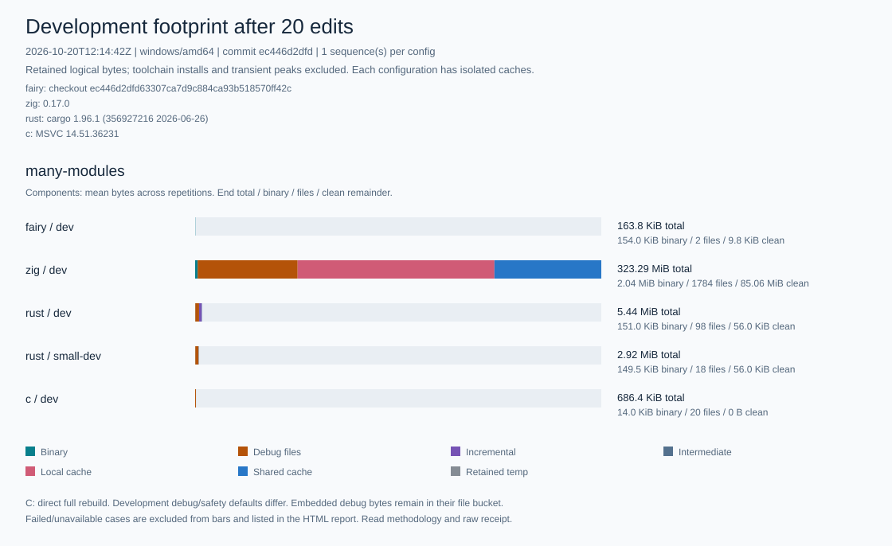

# Fairy C

<p align="center">
  <picture>
    <source media="(prefers-color-scheme: dark)" srcset="assets/brand/fairyc-logo-horizontal-dark-v2.png">
    
  </picture>
</p>

- Status: Stage 0 implementation prototype
- Scope: general
- Repository type: cli-tool
- Addon: monorepo

- License: [Apache-2.0](LICENSE) for project-owned components; see
  [licensing scope](LICENSING.md) and [third-party notices](THIRD_PARTY_NOTICES.md).

Fairy C is an experimental systems programming language for new native software that needs C-like control and predictable costs, explicit C interoperability, and a safer default resource model without a garbage collector or a heavy runtime.

Fairy C does not aim to outperform every hand-tuned C program, or to make every C ownership graph safe. Its intended advantage is narrower: ordinary Fairy C code carries enough ownership, aliasing, bounds, and effect information for the compiler to reject common failures and still generate competitive machine code, without relying on build-mode-dependent undefined behavior.

<a id="human-quickstart"></a>
## Quickstart

### Get the compiler

Fairy C does not yet offer pre-built public installers. To build the compiler from source, follow the [Windows compiler build guide](DEVELOPMENT.md#building-the-windows-compiler-binary). If you are using an experimental ZIP distribution, extract it and keep the license files together. Go and Bun are required only for building the compiler from source, not for running the built executable.

The recommended environment is Windows (x86_64/AMD64) with MSVC and the Windows SDK.
Install Microsoft's [C++ Build Tools](https://learn.microsoft.com/en-us/cpp/overview/acquire-msvc)
(Desktop development with C++ workload) to enable native compilation and testing.
WSL2 or a virtual machine is not required; basic source checking and semantic analysis run independently of the C toolchain. Other targets and CI probes are experimental and not yet guaranteed for general use.

Contributors can also build and test the compiler on Linux using Go with GCC or Clang (see [Contributing](CONTRIBUTING.md)). SDK stage0.79 provides Linux support for atomic file replacement, exact reads, file removal, and UTF-8 process arguments. For example, the [task-manager example](examples/task_manager_cli/README.md) supports native builds and tests via `fairyc build/run/test --native` on Linux (amd64) with GCC or Clang.

### Create, test, and run

Once `fairyc` is built, you can create and test a new project starter from any working directory. If `fairyc` is not on your PATH, use its relative or absolute path.

```text
fairyc new hello-fairy --uid example.hello-fairy
cd hello-fairy
fairyc check
fairyc check --locked
fairyc test --list --json --locked
fairyc test --json --locked
fairyc test --locked
fairyc test --native --locked
fairyc test --native --release --locked
fairyc run --locked
fairyc run --release --locked
```

The generated `src/main.fy` contains a minimal complete program:

```text
module main;

pub fn i32 answer() {
    return 42;
}

fn i32 main() {
    return answer() - 42;
}
```

The test runner reports one passed test and no failures, and both run modes exit with code 0.

The first check validates the source files and generates `fairy.lock`. On Windows/amd64 with MSVC installed, `fairyc test --native --locked` compiles each test into an isolated binary image, while `fairyc run --locked` compiles the program through generated C and executes the resulting native binary with stdin attached. The generated `README.md` lists next steps and includes a `std::io::write` example. `fairyc new` never overwrites or merges into an existing directory.

### Project status and reporting issues

This repository provides the Go-based Stage 0 prototype compiler, rather than a self-hosted or production-ready release. Background on verification is in [readiness evidence](docs/ops/parser-public-readiness.md) and the [CI run on `34fe041c`](https://github.com/0disoft/fairyc/actions/runs/35103049037).

For bug reports and general feedback, open a [GitHub Issue](https://github.com/0disoft/fairyc/issues) with the compiler commit or build hash, OS and toolchain version, a minimal reproducible example, expected vs. actual behavior, and the compiler diagnostic output.

Do not post sensitive credentials, confidential code, or vulnerability details in public issues. Report security issues to the maintainer directly.

## Current phase

The Go Stage 0 compiler now implements immutable source bytes, a lossless lexer, compact recoverable
syntax, error-free AST lowering, typed HIR, resource and borrow Flow, verified MIR, a bounded
interpreter, deterministic C11 transport, strict local workspaces, stable `new`/`check`/`build`/
`run`/`test`/C emission commands, and experimental Atlas fact export.

The step-by-step record of what each phase implemented, including the command surface at the
time, has moved to [docs/development/implementation-status.md](docs/development/implementation-status.md).

## Try the current prototype

Examples that drive a checkout directly with `go run` have moved to
[docs/development/prototype-usage.md](docs/development/prototype-usage.md). They are examples, not
an authority on command behavior.

## Build footprint

A local synthetic benchmark compares retained build outputs and cache growth for Fairy C, Zig,
Rust, and C. Run configuration: commit `ec446d2d`, Windows/amd64, 20 source edits, one sequence per configuration.



[Methodology](docs/benchmarks/README.md) ·
[Raw receipt](docs/benchmarks/latest/receipt.json) ·
[Full footprint SVG](docs/benchmarks/latest/footprint.svg) ·
[Download HTML report](docs/benchmarks/latest/report.html)

[File-search CLI benchmark](docs/benchmarks/file-search/README.md): buffered file I/O with the same
matching rules in all four languages, including Rust's default and `small-dev` profiles.

Download the HTML report and open it locally; GitHub's file view does not run it.

## Design anchors

- [Architecture](ARCHITECTURE.md)
- [Language and grammar](docs/development/source-of-truth-language-and-backend.md)
- [CLI contract](docs/cli/stable-cli-contract-v0.md)
- [Source and design references](docs/development/source-of-truth.md)
- [Contributing](CONTRIBUTING.md)

## Working name and tools

- Language name: Fairy C
- Compiler command: `fairyc`
- Short alias: `fyc` is reserved but not yet adopted
- Source extension: `.fy`
- `fc` is not used as the executable name

Repository hygiene and generated design-document ownership are governed by `AGENTS.md`, `VALIDATION.md`, and `.ssealed/manifest.json`.
