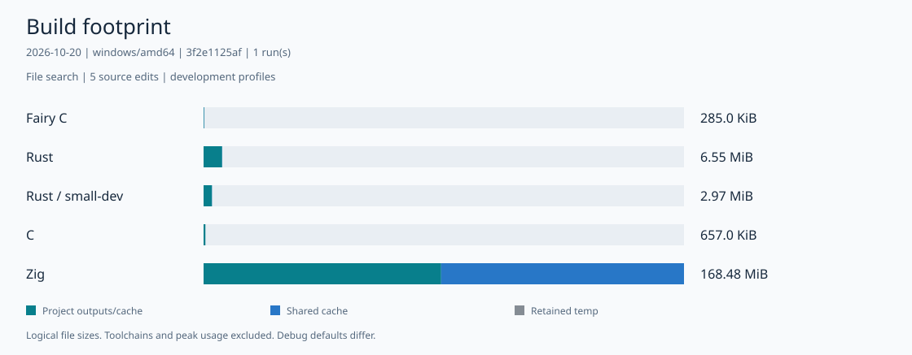

# File-search CLI benchmark

Measured on 2026-10-21 (KST) at commit `3f2e1125` (windows/amd64).
Each configuration searches the same 1 MiB file, with five source edits and one cold-to-clean sequence.
All 35 post-build executions matched the reference output, including the public-signature edit.
The command timeout is 20 minutes; an [earlier attempt](timeout-10m.receipt.json) hit the 10-minute
limit during Zig's cold build.

[English](report.html) · [한국어](report.ko.html) · [中文](report.zh.html) · [Español](report.es.html) · [Français](report.fr.html) · [हिन्दी](report.hi.html)



## Build time (ms)

| Language / profile | Cold | No-op | Private edit (median) | Public edit |
| --- | ---: | ---: | ---: | ---: |
| Fairy C / dev | 4070.3 | 2057.3 | 2332.2 | 5685.6 |
| Rust / dev | 2448.6 | 920.0 | 2138.4 | 1855.4 |
| Rust / small-dev | 1295.4 | 327.9 | 1324.9 | 2703.8 |
| C / dev | 2423.6 | 542.1 | 600.0 | 713.2 |
| Zig / dev | 545327.0 | 219.5 | 11019.4 | 12355.4 |

The four implementations scan files in 4 KiB chunks. The corpus includes CRLF, UTF-8, NUL,
long lines, a match spanning reads, and a final line without a newline. No third-party packages
are used, so this snapshot does not estimate dependency-heavy Rust target growth.

The chart includes retained project outputs and experiment shared caches. Toolchain installation
and peak disk use are excluded. C recompiles on every invocation, including no-op; development
debug information and incremental defaults differ between toolchains. Program execution verifies
correctness; runtime throughput is not measured.

[Methodology and commands](../README.md#workloads) · [Raw receipt](receipt.json) ·
[Full footprint SVG](footprint.svg) · [Growth SVG](growth.svg)

## Reproduce

```text
go run ./tools/dev/fairyc-bench run --output .cache/bench-file-search-new --workloads file-search --profiles dev,small-dev --languages fairy,rust,c,zig --edits 5 --timeout 20m
```

Add `--zig /path/to/zig` if Zig is not on PATH. Render the resulting receipt with the
[report command](../README.md#quick-start).
