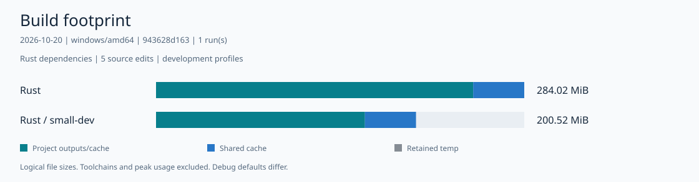

# Rust dependency build footprint

Measured 2026-10-21 (KST) on Windows amd64 at clean commit `943628d1`.

This Rust-only snapshot builds the `rust-dependencies` workload: a JSON-lines CLI using `clap` 4
with derive, `serde` 1 with derive, `serde_json` 1, and `regex` 1. Cargo.lock resolves 32 direct
and transitive registry packages and is shared by both profiles. Each profile runs one
cold-to-clean sequence with five source edits.

[English](report.html) · [한국어](report.ko.html) · [中文](report.zh.html) · [Español](report.es.html) · [Français](report.fr.html) · [हिन्दी](report.hi.html)



| Profile | Target before edits (MiB) | Target after five edits (MiB) | Target growth (MiB) | Shared Cargo cache (MiB) | After clean (MiB) |
| --- | ---: | ---: | ---: | ---: | ---: |
| `dev` | 237.46 | 244.64 | 7.18 | 39.38 | 39.38 |
| `small-dev` | 161.14 | 161.14 | 0.00 | 39.38 | 39.38 |

Target before edits is the cold build; the after-five column is the final edit build.
`small-dev` uses Cargo development defaults with `debug = "line-tables-only"` and
`incremental = false`. Both profiles share the same lockfile, so their shared cache and
after-clean values match.

`cargo fetch --locked` runs before timing, so network fetch time is excluded. Retained registry
source, archives, and index files are included separately in the shared Cargo cache column. Timed
builds use `cargo build --offline --locked`; clean removes `target/` and keeps the isolated Cargo
home.

All 14 post-build executions matched the reference output.

These are synthetic Rust profile comparisons. They do not rank Rust against Fairy C, Zig, or C.

[Methodology](../README.md#workloads) · [Raw receipt](receipt.json) ·
[Full footprint SVG](footprint.svg) · [Growth SVG](growth.svg)

## Reproduce

```text
go run ./tools/dev/fairyc-bench run --output .cache/bd-new --languages rust --workloads rust-dependencies --profiles dev,small-dev --edits 5 --timeout 10m
```

Keep the Windows output path short; MSVC link steps can fail with long paths.

Render the receipt with the [report command](../README.md#quick-start).
